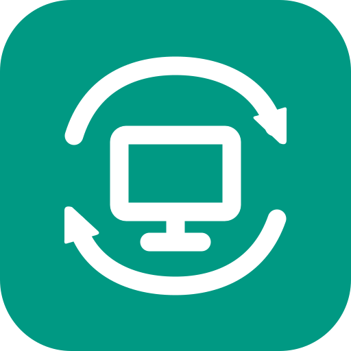
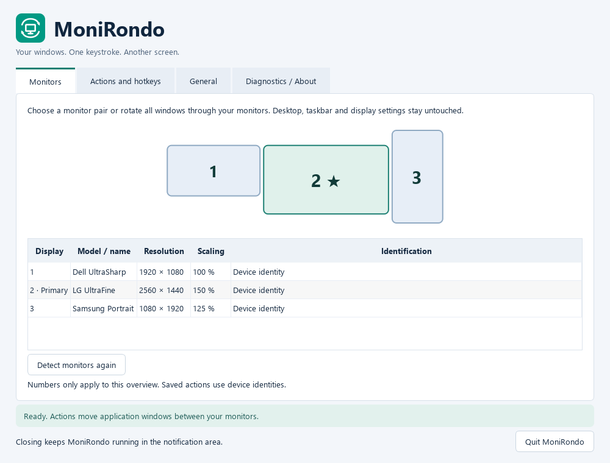
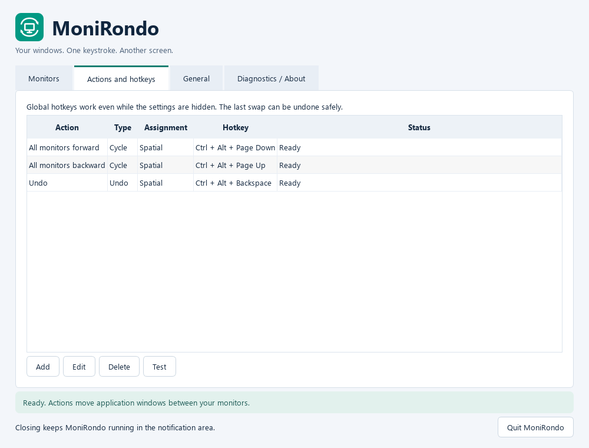

<p align="center">
  
</p>

<h1 align="center">MoniRondo</h1>

<p align="center">
  <b>Your windows. One keystroke. Another screen.</b><br>
  A free Windows tray app that swaps application windows between monitors with a global hotkey.
</p>

<p align="center">
  <a href="https://github.com/loopnlucid/MoniRondo/releases/latest">Download</a> ·
  <a href="#quick-start">Quick start</a> ·
  <a href="#building-from-source">Build</a> ·
  <a href="CONTRIBUTING.md">Contributing</a> ·
  <a href="CHANGELOG.md">Changelog</a>
</p>

<p align="center">
  
</p>

## Features

- **Swap a monitor pair** – every window on monitor A moves to monitor B and vice versa. Other monitors stay untouched.
- **Rotate through all monitors** – forward or backward, in spatial order or a fixed order of your choice (including a subset).
- **Global hotkeys** – work even while the settings are hidden. Conflicts with other applications are detected and reported.
- **Safe Undo** – puts the windows of the last swap back, skipping windows that were closed or moved in the meantime.
- **Keeps your layout** – maximized windows stay maximized, minimized stay minimized. Snapped halves, quarters and thirds are re-created on the target monitor, even with different resolutions and DPI scaling.
- **Stable monitor identities** – actions remember your displays by device path, not by Windows' display number.
- **Multilingual** – English, German (Deutsch), Spanish (Español) and French (Français).
- **Private and lightweight** – no administrator rights, no network access, no telemetry, no window titles in logs. Portable: no installer.

Requires Windows 10 or 11, 64-bit.

## Quick start

1. Download `MoniRondo-<version>-win64.zip` from the [latest release](https://github.com/loopnlucid/MoniRondo/releases/latest) and extract it.
2. Start `MoniRondo.exe`. Keep the `_internal` folder next to it.
3. Use the suggested hotkeys or define your own under **Actions and hotkeys**:

| Hotkey | Action |
|---|---|
| <kbd>Ctrl</kbd>+<kbd>Alt</kbd>+<kbd>Page Down</kbd> | Rotate all monitors forward |
| <kbd>Ctrl</kbd>+<kbd>Alt</kbd>+<kbd>Page Up</kbd> | Rotate all monitors backward |
| <kbd>Ctrl</kbd>+<kbd>Alt</kbd>+<kbd>Backspace</kbd> | Undo the last swap |

The binary is not code-signed, so Windows SmartScreen may show a warning on first start. Each release ZIP comes with a `.sha256` checksum.

## Usage

<p align="center">
  
</p>

- **Monitors** shows the detected displays. The numbers belong to this overview only and need not match the numbers in the Windows display settings.
- **Actions and hotkeys → Add** creates a pair swap or a cycle. Press a key combination in the hotkey field; saving checks that Windows can register it. If the combination is taken, your previous working hotkey stays active. Windows key combinations, F12 and Ctrl+Alt+Del are reserved.
- **Test**, the tray menu or the hotkey run an action. **Undo** keeps one step in memory.
- **General** contains autostart, tray behavior, the window fitting mode, excluded applications and the **language**. Changing the language takes effect immediately.
- Closing the settings window keeps MoniRondo running in the notification area. Starting it again opens the existing instance. Quit via the tray menu.

By default window sizes are kept in physical pixels and only shrunk when a window does not fit; alternatively windows can scale proportionally to the target work area. The shell, MoniRondo's own windows, hidden helper windows and windows on other virtual desktops are never moved. Some applications refuse or override native moves – see [known limitations](docs/known-limitations.md).

## Data and privacy

| What | Where |
|---|---|
| Settings | `%APPDATA%\MonitorSwap\config.json` (written atomically; a damaged file is backed up with a timestamp) |
| Logs | `%LOCALAPPDATA%\MonitorSwap\logs` (at most four files of about 1 MB; no window titles, document names or screenshots) |
| Autostart | only the value `MonitorSwap` under `HKCU\Software\Microsoft\Windows\CurrentVersion\Run`, and only when you enable it |

The technical name `MonitorSwap` is the app's former name; it is kept so that settings from earlier versions are reused. **Diagnostics / About** offers a copyable diagnostic report (always in English, for bug reports) and opens the log folder.

## Building from source

PowerShell in the project folder, Python **3.12 x64**:

```powershell
python -m venv .venv
.\.venv\Scripts\python.exe -m pip install -r requirements-lock.txt
.\.venv\Scripts\python.exe -m pip install --no-build-isolation --no-deps -e .
.\.venv\Scripts\python.exe -m monirondo
```

Checks and the release build:

```powershell
.\.venv\Scripts\python.exe -m pytest -q
.\.venv\Scripts\python.exe -m ruff check .
.\.venv\Scripts\python.exe -m mypy
.\.venv\Scripts\python.exe scripts/prepare_third_party.py
powershell -NoProfile -ExecutionPolicy Bypass -File scripts/build_windows.ps1
powershell -NoProfile -ExecutionPolicy Bypass -File scripts/smoke_test.ps1
```

The build produces `dist\MoniRondo-<version>\MoniRondo.exe`, `dist\MoniRondo-<version>-win64.zip` with its checksum, and a source ZIP. PyInstaller bundles Python and Qt as dynamic libraries, so no separate Python installation is needed to run the app. `prepare_third_party.py` downloads the unmodified Qt/PySide sources once; they ship with the release together with the LGPL/GPL texts.

The pure logic runs on any OS: `PYTHONPATH=src python -m pytest -q -m "not windows"` (UI tests are skipped without PySide6). Native move tests only move short-lived test windows and are opt-in:

```powershell
.\.venv\Scripts\python.exe -m pytest -q tests/test_windows_integration.py --run-native-moves
```

More: [architecture](docs/architecture.md) · [technical decisions](docs/decisions.md) · [test record](docs/testing.md) · [swap diagnostics](docs/swap-diagnostics.md)

## Translations

UI texts live in [`src/monirondo/locales`](src/monirondo/locales), one JSON file per language with English as the reference. Corrections and new languages are welcome – see [CONTRIBUTING.md](CONTRIBUTING.md#translations).

## License

MoniRondo is licensed under the [MIT License](LICENSE). Qt and PySide6 are used under the LGPLv3; see [third-party licenses](docs/third-party-licenses.md). Release folders contain all license texts under `LICENSES`.

MoniRondo was called **MonitorSwap** up to version 1.0.4.
